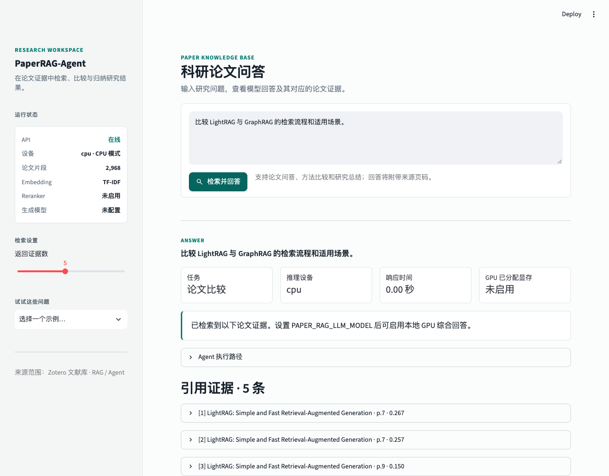

# Evidence Layout Lab

《AI技术科研实践应用》课程实践项目，对应课程报告《大模型辅助科研背景下的RAG&Agent研究策略》第 3.2 节“通过控制实验解释机制”。保留论文检索问答，新增双跳推理受控实验，用同一套本地模型调用实现“研究假设—控制实验—结果分析—适用边界”。

**研究问题：在关键事实与输入长度相同的条件下，证据分散是否影响跨文档推理？集中组织关联证据能否改善表现？**

课程报告已随仓库收录：[阅读或下载课程报告](docs/course-report.docx)。文件内容保持原样；报告是研究方案背景，不是本项目已取得实验结论的证明。项目展示名与本地目录已调整，GitHub 仓库名暂保留，后续由作者手动修改。

## 第一版范围与验证状态

| 模块 | 状态 |
| --- | --- |
| 论文问答 | 保留 PDF 解析、检索、可选重排与引用 |
| 公共生成 | 同一模型加载、提示构造、长度检查与计时 |
| 受控实验 | 必要证据、集中、分散三种条件 |
| 批量评测 | 逐次保存、配置核对、断点恢复 |
| 结果界面 | 论文问答、实验对比、失败案例 |
| 真实检索聚合 | 后续阶段，第一版不实现 |
| AMD GPU 验收 | 提供命令；本轮尚未在 AUP 执行 |

本机通过上下文/评分单元测试、真实 PDF 检索和 Streamlit 页面测试；本机没有 PyTorch/Transformers，**尚未验证真实模型生成及 AMD GPU 端到端运行**。仓库不发布虚构的正确率或 GPU 实测结果，也不新增未经确认的依赖。

## 实验设计

| 条件 | 作用 |
| --- | --- |
| 仅必要证据 | 检查两条事实是否足以让模型解题；输入较短 |
| 证据集中 | 两条必要证据相邻；使用标准标签的机制对照 |
| 证据分散 | 两条必要证据位于相对位置；与集中条件等材料、等 token |

集中与分散使用完全相同的材料块、编号与来源，只改变排列。每题材料数量为偶数。以 6 块为例，集中位置依次为相邻的三组位置；分散位置依次为间隔三块的三组位置。交换两条关键证据的顺序后，每条关键证据在每个条件中都恰好覆盖全部 6 个块位置，避免集中条件跨首尾边界。干扰块也随排列调整。

程序用实际模型 tokenizer 记录完整提示词 token 数、材料 token 数、块位置与证据起始 token 偏移；集中/分散的完整输入长度不一致时拒绝该配对并记录错误。块位置平衡不能保证 token 绝对位置完全平衡，因此保留偏移供结果分析；该限制应随结论报告。超出输入或模型上下文预算时直接报错，禁止静默截断；达到输出 token 上限时记录 `finish_reason=length`，不把输出截断隐藏起来。

集中条件依赖标准必要证据标签，**只能用于机制对照，不能宣称实际系统已经能自动找到并集中正确证据**。真实检索与仅使用可获取信息的规则聚合留到后续，避免把检索遗漏和推理失败混为一谈。

每题在两种证据顺序下各运行 3 个集中排列、3 个分散排列、1 次必要证据条件，共 14 次生成。条件执行顺序由固定种子打散；默认贪心解码。种子控制调度，不承诺不同 GPU 内核间逐位复现。排列属于同一道题的重复观测，不能充当独立题目扩大样本量。

## 数据与人工核验

首批提供 8 道**封闭世界合成演示题**，探索集和验证集各 4 道。人物、项目与来源均为虚构，全部人工核验状态为 pending；不是正式基准。每题包括问题、答案及别名、两条必要证据、干扰材料、来源、事实组与人工核验状态。必要证据编号随题变化，提示词不提供标准引用编号。格式与核验方法见 [任务集说明](data/experiments/README.md)。

先用探索集演示运行检查流程，再人工核对事实、唯一答案、来源和干扰材料。核验后设置 `human_review.status=verified`，填写 `reviewer` 和 `reviewed_at`。正式研究请建立足量、可溯源的新任务集。同一事实组合及其不同排列或改写必须处于同一划分；验证集不能启用跳过核验选项。正式比较前固定任务集、规则和模型 revision。

## 安装与普通论文问答

需要 Python 3.10+。以下命令在项目根目录执行。保留兼容的 Python 包名 `paper_rag` 和现有环境变量前缀，原有启动方式继续可用。

```bash
python3 -m venv .venv
source .venv/bin/activate
python3 -m pip install -r requirements.txt
python3 scripts/check_runtime.py
python3 scripts/build_index.py
PYTHONPATH=src python3 -m uvicorn paper_rag.api:app --host 0.0.0.0 --port 8000
```

另开终端，激活同一个环境后启动界面：

```bash
python3 -m streamlit run src/paper_rag/ui.py --server.address 0.0.0.0 --server.port 8501
```

没有配置生成模型时，问答返回检索证据并明确提示未生成综合回答。设置本地模型后问答与实验共用生成模块。关键词路由只用于普通问答，不是实验方法。普通问答没有标准必要证据标签，其必要证据覆盖率保持空值；引用编号合法不代表内容得到支持。

旧版问答界面截图仅供参考，不是本版实验结果或 GPU 实测：



## 在 AUP 执行实验

完整环境准备、结果验收、恢复和端口访问步骤见 [AUP 操作指南](docs/server.md)。先使用课程现有 ROCm PyTorch 环境；不要重装或升级镜像中的 PyTorch。首次模型下载需要网络、磁盘与内存；先只加载一个生成模型，实验不需要同时加载 Embedding 或 Reranker。

```bash
export PAPER_RAG_DEVICE=rocm
export PAPER_RAG_LLM_MODEL=Qwen/Qwen2.5-3B-Instruct
export PAPER_RAG_MAX_NEW_TOKENS=128
export PAPER_RAG_MAX_INPUT_TOKENS=4096
python3 scripts/check_runtime.py --require-amd --output results/runtime.json
python3 scripts/run_experiment.py --output results/smoke --limit 1 --allow-unreviewed --require-gpu
python3 scripts/verify_experiment.py results/smoke
```

这是一题、14 次真实调用的探索演示，不是正式比较。模型示例来自 [Qwen 官方模型卡](https://huggingface.co/Qwen/Qwen2.5-3B-Instruct)，实际显存与兼容性须在分配到的 AUP 环境核实。首次运行保存模型实际 revision；正式实验建议用 `PAPER_RAG_MODEL_REVISION` 固定模型仓库 commit，或使用内容不变的本地模型快照。

中断后原样重跑同一命令，会跳过已有成功记录；错误默认也保留，显式传入 `--retry-errors` 才重试，并归档旧错误。单个结果以原子替换落盘；被中断的调用会重跑，同一输出目录有进程锁。代码、数据、配置、模型实际 revision 或运行环境变化时拒绝混入旧结果，应改用新目录。进程被终止的瞬间不能保证有异常记录，但此前落盘的调用可恢复。

```bash
python3 scripts/run_experiment.py --output results/smoke --limit 1 --allow-unreviewed --require-gpu --retry-errors
```

人工核验并冻结独立任务集后，再运行完整探索与验证；不要对演示数据直接宣称正式结论：

```bash
python3 scripts/run_experiment.py --dataset data/experiments/two_hop_verified.jsonl --output results/exploration --split exploration --require-gpu
python3 scripts/run_experiment.py --dataset data/experiments/two_hop_verified.jsonl --output results/validation --split validation --require-gpu
```

上面的核验版数据文件需要自行准备，仓库不伪造人工核验记录。

## 评分与结果追溯

| 指标 | 规则 |
| --- | --- |
| 答案正确率 | JSON 短答案经大小写、全半角、空白、标点规范化后匹配标准答案或别名 |
| 必要证据覆盖率 | 引用编号是否包含全部必要证据；仅是选择覆盖指标 |
| 引用支持率 | 人工逐条标注引用是否支持回答；未核验为空值 |
| 成本 | 完整输入/实际输出 token、生成调用耗时、逐次峰值内存 |
| 配对变化 | 同题同排列下集中与分散的对错和运行状态 |

输出必须是 `{"answer":"简短答案","citations":["实际证据编号"]}`，代码围栏或额外解释视为格式错误。异常和格式错误计入失败或错误答案；汇总先对每题各排列取均值，再对题取均值。程序不自动猜测推理错误原因。人工分类支持证据遗漏、关联错误、无依据回答、输出格式错误；没有分类时保留空值。引用支持率只对已完成逐条人工核验的记录计算，同时显示已核验数量。

耗时是模型预热未剔除的单次输入编码/传输与生成调用时间，不含模型首次加载；首次调用和后续调用的成本应分别检查。GPU 峰值在每次调用前重置，包含已驻留模型的内存，属于 PyTorch 进程分配/保留内存，不等于设备总内存占用。启动阶段或生成阶段失败保存异常；不能取得的指标为空。

每个输出目录包含：

- `manifest.json`：数据和代码指纹、模型 revision、运行配置、环境及预期记录数量。
- `records/`：每次调用的完整题目、上下文、提示词、模型输出、运行指标或异常。
- `evaluation.json`：逐题评分、汇总与配对变化，可按运行编号追溯原始输出。
- `attempts/`：显式重试前的旧错误；`startup_error.json`：加载或运行初始化异常（发生时）。

人工核验示例见 [引用核验格式](docs/citation-review.example.json)。复制示例并将键替换为真实运行编号，对该次实际输出的每个引用填写 true/false、评审人和日期，然后重新评分：

```bash
python3 scripts/run_experiment.py --output results/smoke --evaluate-only --reviews results/reviews.json
```

Streamlit 的“实验对比”和“失败案例”只读取结果；无需为看结果启动 API，也不会偷偷重新推理。失败案例可并排查看排列、证据、回答、评分与完整记录。若记录数未达到预期，会提示结果不完整。结果目录默认被 Git 忽略，需另外备份，不随代码 push 上传。

## 项目文件

- `src/paper_rag/generation.py`：公共模型调用。
- `src/paper_rag/experiments/context.py`：数据校验、材料排列与 token 位置。
- `src/paper_rag/experiments/runner.py`：批量执行与恢复。
- `src/paper_rag/experiments/evaluate.py`：评分与配对分析。
- `scripts/run_experiment.py`：实验及离线评分入口。
- `scripts/verify_experiment.py`：真实 AMD 生成记录验收。
- `src/paper_rag/core.py`：原有 PDF 解析与检索，第一版不调整算法。
- `src/paper_rag/api.py`、`src/paper_rag/ui.py`：普通问答与三页面展示。

## 配置与测试

配置示例见 [.env.example](.env.example)。该文件仅供参考，不会自动加载；运行前在各终端显式 export，或从可信的本地配置文件 source。现有检索模型变量保留；实验只需要生成模型。新增输入预算与模型 revision 配置，默认贪心解码，不静默截断。

新增测试没有 mock，覆盖数据泄漏、材料和位置、评分、真实 PDF 检索、页面切换。按范围运行：

```bash
python3 -m compileall -q src scripts tests
PYTHONPATH=src PAPER_RAG_DEVICE=cpu PAPER_RAG_LLM_MODEL= PAPER_RAG_EMBEDDING_MODEL= PAPER_RAG_RERANKER_MODEL= python3 -m pytest tests/test_experiments.py tests/test_api.py tests/test_ui.py -q
```

真实模型生成、恢复后的真实推理和 ROCm 内存统计仍需按 AUP 指南实测。当前不包含训练、多智能体、动态权限、自动引用语义判定或统计显著性结论。

## 官方资料

- [AUP Learning Cloud](https://amdresearch.github.io/aup-learning-cloud/)
- [PyTorch HIP / ROCm 语义与 GPU 内存](https://docs.pytorch.org/docs/stable/notes/hip.html)
- [Qwen2.5-3B-Instruct 官方模型卡](https://huggingface.co/Qwen/Qwen2.5-3B-Instruct)
