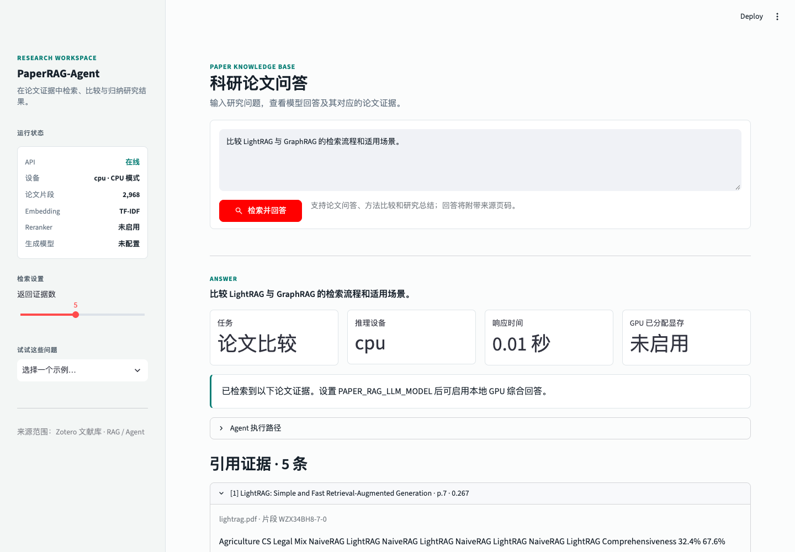
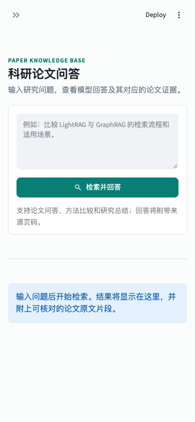

# PaperRAG-Agent

面向 RAG 与 Agent 研究的论文检索问答工作台。项目读取随仓库发布的 Zotero 论文 PDF，完成文本解析、证据检索、任务路由和带来源的回答；可在 AMD ROCm GPU 上运行向量检索、重排和本地大语言模型。

> 当前版本已实现可运行的论文 RAG Agent 原型。没有配置生成模型时，系统会返回检索到的证据并明确提示尚未生成综合回答；配置模型后才会调用本地 LLM。请勿把检索基线描述为完整生成式问答。

## 界面预览

桌面端包含运行状态、检索问题、回答指标和可展开的论文来源；窄屏下侧栏可折叠，主要控件纵向排列。截图展示 CPU/TF-IDF 基线模式，不代表 GPU 推理的实测截图。






## 功能

- 从论文 PDF 提取页面文本并生成可溯源片段，引用包含论文标题、文件名、页码和片段 ID。
- TF-IDF CPU 基线；设置句向量模型后启用 Sentence Transformers 检索。
- 可选 CrossEncoder 重排和 Hugging Face 本地生成模型。
- 根据问题将 Agent 任务分为论文问答、总结或比较，并展示执行路径。
- FastAPI 提供健康状态和检索接口，Streamlit 提供桌面及窄屏友好的交互界面。
- 支持 AUP Learning Cloud 上已配置 ROCm PyTorch 的单机 GPU 环境；项目依赖不会主动安装 PyTorch。

当前项目使用 GPU 做 Embedding、可选重排和 LLM 推理；尚未实现模型微调/训练流程。课程若要求训练实验，需要在此原型上另行增加训练脚本与实验记录。

## 架构与请求流程

```text
Zotero 论文 PDF
       |
       v
文本解析与分页分块 --> TF-IDF CPU / GPU Embedding --> 可选 GPU Reranker
                                                       |
用户问题 --> Agent 任务路由 --------------------------+
                                                       v
                                              可选 GPU 本地 LLM
                                                       |
                                                       v
                              回答 + 论文标题/页码/证据片段
```

Embedding、重排和生成模型分别通过环境变量选择。检索向量缓存于 `data/index/`，Hugging Face 模型缓存位于用户缓存目录；它们均不纳入 Git。

## 快速开始

需要 Python 3.10 或更新版本。以下示例在项目根目录运行：

```bash
python3 -m venv .venv
source .venv/bin/activate
python3 -m pip install -r requirements.txt
python3 scripts/check_runtime.py
python3 scripts/build_index.py
```

分别在两个终端启动 API 和界面：

```bash
PYTHONPATH=src python3 -m uvicorn paper_rag.api:app --host 0.0.0.0 --port 8000
```

```bash
streamlit run src/paper_rag/ui.py --server.address 0.0.0.0 --server.port 8501
```

本机打开 Streamlit 输出的地址。部署到 AUP 时，端口访问方式由当前 JupyterHub/AUP 环境提供；具体步骤见 [AUP 云服务器指南](docs/server.md)。

## AUP GPU 配置

AUP 环境若已预装 ROCm 版 PyTorch，先运行 `python3 scripts/check_runtime.py` 确认 HIP 与 GPU 可用，再安装项目其余依赖。**不要为了安装本项目而重装或升级 PyTorch**，否则可能破坏镜像中与 ROCm 配套的版本。

```bash
python3 -m pip install -r requirements.txt
export PAPER_RAG_DEVICE=rocm
export PAPER_RAG_EMBEDDING_MODEL=BAAI/bge-m3
export PAPER_RAG_RERANKER_MODEL=BAAI/bge-reranker-v2-m3
export PAPER_RAG_LLM_MODEL=Qwen/Qwen2.5-3B-Instruct
```

上述模型配置会在第一次加载时下载模型权重，需要网络、磁盘和可用显存。可以先只设 Embedding，分阶段验证 GPU 检索，再按资源情况增加重排和生成模型。完整启动、资源观察与会话恢复步骤见 [docs/server.md](docs/server.md)。

## API

- `GET /health`：查看片段数、运行设备及模型配置。
- `POST /query`：输入问题并返回回答、Agent 路径、证据及 GPU 指标。

查询示例：

```bash
curl -X POST http://localhost:8000/query \
  -H 'Content-Type: application/json' \
  -d '{"question":"LightRAG 和 GraphRAG 的主要区别是什么？","top_k":5}'
```

## Zotero 论文

首批论文清单见 [data/papers/manifest.json](data/papers/manifest.json)，PDF 位于 `data/papers/`。清单包含 Self-RAG、FLARE、CRAG、LightRAG、GraphRAG、HippoRAG、Adaptive-RAG 和 A-RAG 等主题。新增论文时，添加获准使用的 PDF，并按清单现有格式登记文件名、标题和 Zotero key，然后重新构建索引。

## 配置参考

环境变量示例见 [.env.example](.env.example)。常用项：

- `PAPER_RAG_DEVICE`（默认 `auto`）：设备选择，可设为 `auto`、`cpu` 或 `rocm`。
- `PAPER_RAG_EMBEDDING_MODEL`（默认空）：向量检索模型；留空使用 TF-IDF。
- `PAPER_RAG_EMBEDDING_BATCH_SIZE`（默认 `8`）：建索引时的编码批大小。
- `PAPER_RAG_RERANKER_MODEL`（默认空）：可选 CrossEncoder 重排模型。
- `PAPER_RAG_LLM_MODEL`（默认空）：可选 Hugging Face 生成模型。
- `PAPER_RAG_MAX_NEW_TOKENS`（默认 `512`）：单次回答最大生成 token 数。
- `PAPER_RAG_API_URL`（默认 `http://localhost:8000`）：Streamlit 调用的 API 地址。

## 验证

```bash
python3 -m compileall -q src scripts tests
PYTHONPATH=src pytest -q
```

## 文档

- [AUP Learning Cloud 部署、GPU 资源使用和故障恢复](docs/server.md)
- [ROCm 官方文档](https://rocm.docs.amd.com/en/latest/)
- [AUP Learning Cloud 官方文档](https://amdresearch.github.io/aup-learning-cloud/)
- [AUP 单节点安装说明](https://amdresearch.github.io/aup-learning-cloud/installation/single-node.html)
